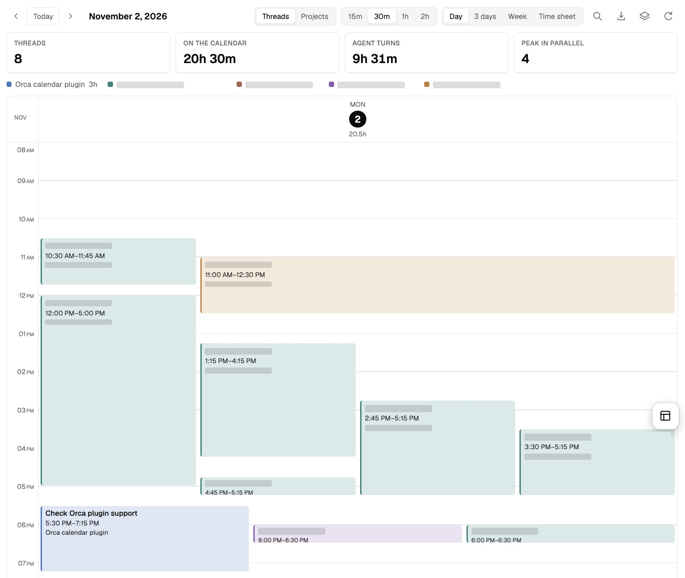
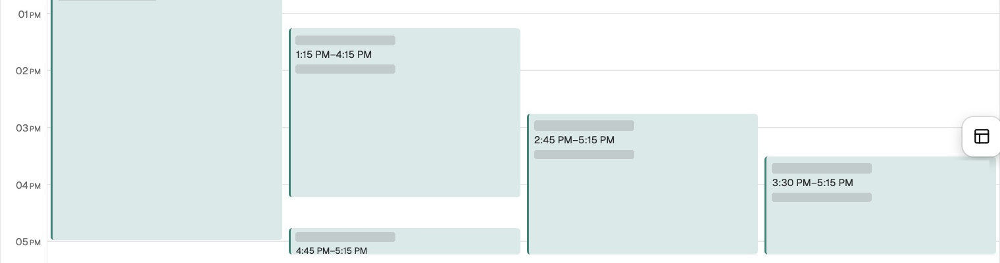

# Activity Calendar for Orca

A calendar of your coding-agent work, inside Orca.

Activity Calendar is a free Orca plugin that turns your local **Codex and Claude session history** into a timeline in the **right sidebar**. See which threads worked during a day or week, when agents overlapped, and what each session worked on. It opens in **Day** view and uses Orca’s theme.

There is no manual timer or external account to set up. The plugin builds the calendar from history already recorded on your computer.

## Why use it?

When you run several agents across projects and worktrees, a list of chats makes it hard to reconstruct the day. You may remember the task but forget which thread handled it, when it ran, or what else was running alongside it.

Activity Calendar puts those sessions on one timeline. Use it to review a busy day, return to a task, understand how much agent work happened in parallel, or prepare a work recap without opening every conversation.

## What it helps you do

| You want to… | How the calendar helps |
| --- | --- |
| Review a day or week | Switch between Day, 3 days, and a Monday-starting Week view. |
| See parallel agent work | Overlapping blocks appear side by side; **Peak in parallel** shows the highest overlap of recorded turns. |
| Follow a worktree across agents | Every agent in the same worktree shares a color. Color assignments persist across dates and reopening the panel. |
| Get a project overview | Switch from **Threads** to **Projects**. Merged project blocks show color strips for their contributing worktrees. |
| Revisit what a session worked on | Open a block to inspect its Orca name, original request, latest response excerpt, session ID, and recorded turns. |
| Prepare a status update | **Copy work recap** collects titles and latest recorded response excerpts for threads active in the selected period. |
| Review or export agent hours | **Time sheet** shows weekly recorded hours by thread and day, with CSV export. |
| Narrow the view | Filter by project or provider, search task text, or click a worktree in the color legend. |

Subagents and sessions outside Orca can be included through **Data sources**. The calendar refreshes as local history changes.

## Screenshots

These are crops of the live Orca calendar using real recorded activity. Gray masks cover private task and worktree labels. The second image is a close-up of the same Day view.

### Day overview

The summary shows thread counts, calendar time, recorded agent time, and peak parallel activity. Colored blocks show when each thread worked.



### Parallel threads in one worktree

These overlapping threads share a worktree, so they share a color. Their positions and time labels show how the work overlapped.



## Install in Orca

Requires **Orca 1.4.246 or later**, with its supported panel-to-worker bridge. This release contributes a **calendar icon in Orca’s right sidebar**. Clicking it opens the live calendar inside that panel.

The [community listing](https://www.onorca.dev/plugins/bhojanibilal24/orca-activity-calendar) provides the install link once Orca’s directory has indexed the release. You can also install the published release directly:

1. In Orca, open **Settings → Plugins → Add plugin → From a Git URL…**
2. Paste `https://github.com/bhojanibilal24/orca-activity-calendar#v0.1.3`.
3. Review the worker access, install, and enable the plugin.
4. Click the **calendar icon in the right sidebar**.

This plugin has been tested on macOS with Orca 1.4.246; Windows and Linux have not yet been verified.

### Install from source

To install from source, build the installable folder with Node.js 22.13 or later. No packages need to be installed.

1. Run `npm run package`.
2. In Orca, open **Settings → Plugins** and turn on plugins if needed.
3. Choose **Install plugin → Local folder** and select `dist/bhojanibilal24.activity-calendar`.
4. Review the worker access and enable it.
5. Click **Activity Calendar** (the calendar icon) in the **right sidebar**. Resize the panel to see more days.

The sidebar uses Orca’s supported worker bridge for local history, the native save dialog for CSV, and Orca’s live theme tokens. Day is preselected whenever the panel loads. The refresh button and **Activity Calendar: Refresh History** command rescan history; agent-status events and a 15-second incremental scan update an open calendar. Orca may stop an idle worker and restart it on the next panel request.

A folder may also be loaded during development using `orca plugin dev load . --json`. If Orca asks for approval, review its reported access before approving the exact fingerprint. `orca plugin open bhojanibilal24.activity-calendar --panel calendar --json` opens a loaded panel (the plugin key reported by Orca takes precedence).

## How it works

1. **Read local history.** The worker reads supported Codex and Claude JSONL logs and matches provider session IDs to Orca’s saved thread names.
2. **Build the timeline.** Recorded turns supply the activity intervals. Nearby turns in the same thread can be merged into calendar blocks, which are rounded to 15-minute slots.
3. **Explore the result.** Orca’s panel bridge delivers the data to the sidebar. Filter it, inspect threads, copy a recap, or export a timesheet. Timesheets use recorded turn time, while the calendar uses merged and rounded display blocks.

## Data and access

The worker is ordinary Node code and has access to the user’s filesystem and processes, as Orca explains in its plugin review. Its host capabilities are **`agent:read`** (refresh when agent status changes) and **`storage:own`** (keep worktree colors in the plugin’s own store). This implementation:

- **Reads Orca naming metadata, read-only**, from the active profile’s `profile-state.db`: only the `workspaceSession`, `worktreeMeta`, and `settings` documents. Session IDs match Orca’s agent names, custom names take priority, and the original request remains in thread details. If a saved name is unavailable, the first recorded task is shown. No Orca state is modified. A future Orca schema change may need an adapter update.
- **Reads local provider JSONL files** under `~/.codex/sessions`, Orca’s managed `codex-runtime-home/home/sessions`, and `~/.claude/projects` (using the standard platform-specific Orca application-data directory).
- Stores a small derived index under **Orca Activity Calendar** in your operating system’s application-data directory. The cache contains task titles, short response excerpts, paths, model names, session IDs, and turn timestamps. It does not copy full transcripts or tool output.
- Sends derived history to its own sidebar through Orca’s bridge, in consistent chunks below its message-size limit. The installed plugin does not start a local HTTP server or open browser tabs. Worktree colors use the plugin’s own storage.

By default, only sessions in Orca workspace paths and Orca’s managed session home are shown. **Data sources → Include sessions outside Orca** shows other sessions in the same provider folders. SSH hosts, OpenCode, Pi, other providers, and native chats without provider JSONL transcripts are not indexed. Missing or deleted logs cannot be recovered. Symlinked session directories are not followed.

Cache files are private to the OS user (directory mode `0700`, file mode `0600` on POSIX). Deleting the derived cache directory clears it; the next import rebuilds it from the provider logs. The cache lives outside the repository and release package.

## What the numbers mean

| Metric | Meaning |
| --- | --- |
| **Threads** | Distinct provider sessions with a recorded turn in the selected period. |
| **On the calendar** | The sum of each thread’s displayed blocks, including merged gaps and rounding. Parallel threads count separately. |
| **Agent turns** | The sum of recorded turn intervals. Parallel threads count separately; merged gaps and display rounding are excluded. |
| **Peak in parallel** | The largest number of distinct sessions whose recorded turns overlap. |

For example, two threads with recorded turns from 10:00 to 11:00 contribute **2 threads**, **2 agent hours**, **1 elapsed hour**, and a **peak of 2**.

### What are 15m, 30m, 1h, and 2h?

These buttons set the **maximum gap between turns in the same thread that the calendar combines into one block**. Choose a shorter gap to see separate bursts of work, or a longer gap for a more compact overview.

For example, turns from 09:00–09:20 and 09:50–10:00 contain **30 minutes of recorded turn time**. With a **30m** merge gap, they appear as one **09:00–10:00** calendar block. With **15m**, they stay separate. Their timesheet and CSV total remains **30 minutes**.

Calendar blocks are always rounded outward to 15-minute slots. The gap buttons do not change the underlying recorded turns.

<details>
<summary>Recording details and limitations</summary>

**Threads** means distinct provider sessions with a recorded turn during the selected period, not the number of prompts or necessarily the number of distinct processes. Subagents are excluded by default.

**Agent turn time** sums recorded turn intervals for each thread. Two agents working simultaneously for an hour count as two agent hours. Duplicate or overlapping records of the same session count once. Codex uses explicit `task_started`/`task_complete` boundaries where available; older Codex and Claude turns are reconstructed from message timestamps. Missing completions end at the last recorded activity, rather than counting the following idle days. A recently active unfinished turn is provisionally live for up to three minutes after its last file modification; its duration settles when the completion is recorded.

A recorded turn can include permission waits, process suspension, or computer sleep. Turn time is the span between recorded boundaries, not CPU time; a provider’s separately reported computation duration may differ.

**Calendar blocks** merge turns separated by at most 30 minutes (configurable to 15m, 1h, or 2h), then round outward to 15-minute slots. These display hours include merged gaps and rounding. **Timesheets and CSV always use recorded turn time**, not calendar display time.

**Peak parallel** is the maximum number of distinct sessions with overlapping recorded turns. An end and a start at the same timestamp do not overlap. **Elapsed activity** unions all running intervals so simultaneous work counts once. Calendar days and timesheets use the browser’s local timezone, including daylight saving boundaries.

The work recap quotes agent names and latest response excerpts; it does not independently verify that a task completed or invent commit/PR outcomes.

</details>

These metrics describe **recorded agent activity, not human attendance or personal working time**. A recorded turn can include permission waits, pauses, or computer sleep.

## Development and checks

```sh
npm test
npm run check
npm run package
```

Pure interval and parser tests cover overlap, duplicate transcripts, clipping, missing turn completions, midnight/DST boundaries, and CSV formula injection. History-index tests cover duplicate provider copies, partial transcript writes, cache reuse, and missing provider folders. Worker and client tests verify real-index transport, privacy scope, stable chunks for large Unicode histories, worker restarts, saved colors, and native CSV export. `npm run check` verifies entries, manifest fields, and JavaScript syntax. Use the target Orca’s `plugin validate`, `plugin check`, and native sidebar verification before release.

No runtime dependencies, CDN assets, or telemetry. Geist is bundled locally under the SIL Open Font License; see `web/fonts/OFL.txt`. The UI is plain ES modules and CSS; the worker uses Node’s standard library.

`npm run package` rebuilds the installable folder with only runtime modules, panel assets, and documentation/licenses. Tests, build scripts, and project configuration stay in the repository.

## Contributing / publishing

The source is MIT-licensed. Issues and contributions are welcome in [the GitHub repository](https://github.com/bhojanibilal24/orca-activity-calendar). To publish an update, validate against the target Orca release and push a new `vX.Y.Z` tag matching the manifest version. Keep the `orca-plugin` GitHub topic so the directory discovers releases. See [Orca’s publishing instructions](https://www.onorca.dev/plugins/add). Community listings are checked automatically and do not receive manual review.

Add release screenshots that do not expose personal session data. Do not commit personal transcripts or cache files. Nothing is uploaded or published by the included scripts.

Inspired by the workflows in [BB’s Agent Calendar](https://getbb.app/marketplace/agent-calendar). This is an independent implementation for Orca, with no BB code or assets.
